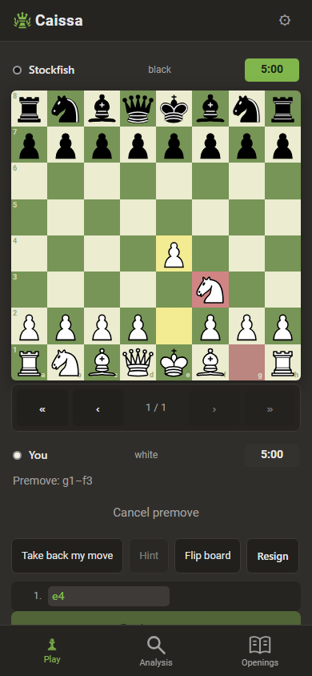
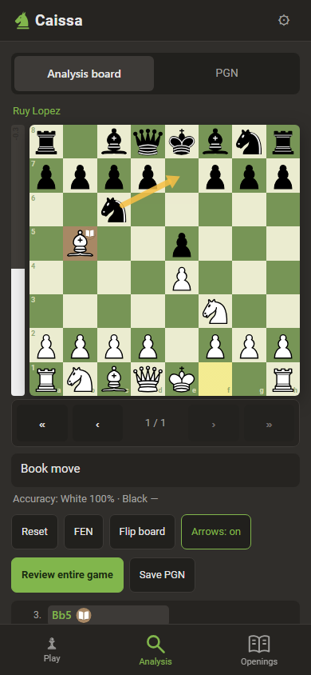
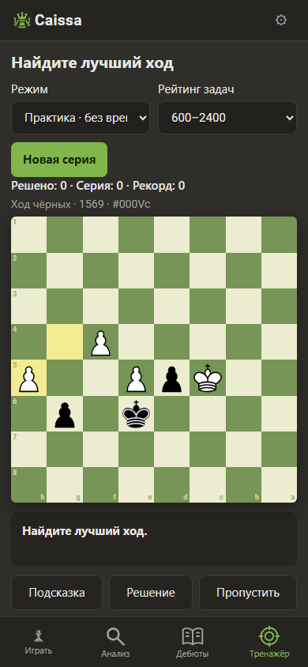

<div align="center">
  
  <h1>Caissa</h1>
  <p>Шахматы, разбор партий и дебюты на Android.</p>
  <p>Русский / English · Stockfish 19 · Android 7+</p>
  <p><a href="https://github.com/glassprincess/CaissaChess/releases/latest">Скачать APK</a> · <a href="docs/BUILDING.md">Собрать из исходников</a> · <a href="docs/CHANGELOG.md">Что нового</a></p>
</div>

<p align="center">
  
  &nbsp;&nbsp;
  
  &nbsp;&nbsp;
  
</p>

## ♞ Играть

Выберите цвет, силу бота и время. Есть три подсказки на партию: стрелка, значок лучшего хода и подсветка поля. Есть премувы,
отмена своего хода и просмотр истории без изменения партии. Премув сразу
показывает фигуру на будущем поле с красной подсветкой; ход выполняется
после ответа бота, если остаётся допустимым.
При сдаче приложение попросит подтверждение.

Боты: **250 · 500 · 1200 · 1800 · 2250 · 2800 · 3500 · 4000 Elo**.
Это условные пресеты; два старших используют полную силу движка с разным
временем расчёта. Контроли: без часов, 1, 3, 3+2, 5, 10 и 15+10.

После игры появляется отчёт: точность, категории ваших ходов и примерный
Elo по этой партии. Его можно закрыть, вернуться к доске и открыть снова.
Готовый разбор не запускается повторно.

## 🔎 Разбирать

Импортируйте PGN или играйте за обе стороны на живой доске. Caissa показывает
оценку позиции, лучший ход, категории и точность отдельно для белых и чёрных.
Есть быстрый и глубокий режимы; стрелки можно выключить.

Подсказки и анализ всегда работают без ограничения силы бота.
Категории рассчитываются собственными правилами и могут отличаться от Chess.com.

## 📖 Учить дебюты

**50 семейств и 395 вариантов**: планы за обе стороны, атаки, контры,
гамбиты и пояснения по ходам. Выбор варианта открывает развилку,
а не последнюю позицию линии.

Встроенная база, игра и разбор работают без интернета. Продолжения из
Lichess Masters загружаются отдельно по кнопке.

## 🎯 Тренироваться

60 смешанных позиций из реальных партий Lichess: найдите всю комбинацию,
а Stockfish проверит ваши ходы и покажет оценку, лучший ответ и продолжение.
Доступны повторная попытка, подсказка и решение. В счёт идут задачи без помощи.

- **Практика** — без часов.
- **Спринт** — три минуты, ошибка отнимает десять секунд.
- **Выживание** — пять минут и три жизни.

Таймер идёт во время вашего размышления. Проверка движком и ответы соперника
его не расходуют. Выход из тренажёра завершает серию; рекорды сохраняются.
Все позиции входят в приложение и доступны без интернета.

## 🎨 Настроить

Темы Classic, Gruvbox и Catppuccin; фигуры Cburnett, Merida, Chessnut и Celtic.
Выбор сохраняется и действует на всех досках. Двойные стрелки во всех режимах
перемещают на пять полных ходов вперёд или назад.

## 📲 Установить

Откройте [последний релиз](https://github.com/glassprincess/CaissaChess/releases/latest)
и выберите APK:

| Файл | Для каких устройств |
| --- | --- |
| `Caissa-1.5.0-arm64-v8a-debug.apk` | Большинство современных Android-телефонов |
| `Caissa-1.5.0-armeabi-v7a-debug.apk` | Устройства с 32-битной ARM-системой |

Минимум Android 7. Приложение обновляется поверх Fisher и предыдущих Caissa
при совпадении подписи. Текущая партия пока не восстанавливается после
завершения процесса приложения.

## 🛠 Собрать

Нужны JDK 17 или 21, Android SDK 35 и Python 3:

```sh
python tools/fetch-engines.py
./gradlew :app:assembleDebug
```

На Windows используйте `gradlew.bat`.
[Инструкция сборки, браузерное превью и проверки →](docs/BUILDING.md)

В репозитории лежат исходники, данные и тесты. Кеши, APK, ключи и крупные
бинарники движка в Git не включены. Stockfish загружает отдельный скрипт
из официального релиза с проверкой SHA-256.

## Автор и лицензии

**GlassPrincess** · [GPLv3](LICENSE).
Stockfish — GPLv3, фигуры cburnett — CC BY-SA 3.0,
дебютные данные Lichess — CC0. [Сторонние компоненты](THIRD_PARTY_NOTICES.md).

Для нового значка выбран [«Ферзь и лавр»](docs/branding/caissa-01.svg).
Он используется в приложении начиная с версии **1.5.0**.
